# 🌸 Kế Hoạch Kỹ Thuật Tổng Thể & Lộ Trình Tiến Hóa Tương Lai (Nihongo Master Roadmap)

> [!NOTE]
> **Định hướng kiến trúc:** Dự án vận hành theo mô hình **Client-Side Native / Offline-First PWA** (Không độ trễ, lưu trữ bảo mật qua Zustand Atomic Selectors + LocalStorage, tương thích ngoại tuyến).

---

## 🗺️ Bức Tranh Tổng Thể Kiến Trúc Dự Án

```mermaid
flowchart TD
    subgraph Milestone_Done["✅ NỀN TẢNG ĐÃ HOÀN THÀNH 100%"]
        P1["Giai đoạn 1: Số hóa 15 bài Dekiru Nihongo N5<br/>(965 từ vựng, 68 ngữ pháp, 60 hội thoại, 80 chữ Hán Canvas, Backup JSON)"]
        P2["Giai đoạn 2: Đấu trường & Bộ gõ WanaKana IME<br/>(Trắc nghiệm, Tự luận rớt âm, Phòng thu Dictation 7 sóng âm, Sakura Match 60s)"]
        P3["Giai đoạn 3: Giám sát năng lực & AI Voice Shadowing<br/>(Smart 3-Tier Mic chống ngắt sớm, Radar 5D SVG, Heatmap 365 ngày)"]
        P4["Giai đoạn 4: Tái cấu trúc kiến trúc & Dọn dẹp Clean Code<br/>(Zustand Atomic Selectors, Quiz Orchestrator Pattern, Chuẩn hóa WanaKana, Vite manualChunks)"]
    end

    subgraph Milestone_Next["🚀 LỘ TRÌNH TIẾN HÓA TIẾP THEO (FUTURE EVOLUTION)"]
        F1["Kế hoạch 1: Cỗ máy Trí nhớ Não bộ FSRS (Free Spaced Repetition Scheduler)<br/>• Thay thế SM-2 bằng giải thuật Anki hiện đại (Stability, Difficulty, Retrievability)<br/>• Giảm 25% số lần ôn tập thừa, bảo toàn 100% dữ liệu cũ"]
        F2["Kế hoạch 2: Phòng Hội Thoại Nhập Vai Tình Huống Gemini AI (Roleplay Scenarios)<br/>• Nhập vai gọi món quán ăn, hỏi đường, mua vé tàu tại Nhật<br/>• Nhận xét ngữ pháp tự nhiên & phát âm chuẩn giọng Tokyo (Google AI Studio Key)"]
        F3["Kế hoạch 3: Trực Quan Hóa Cao Độ Ngữ Điệu (Pitch Accent Waveform Visualizer)<br/>• Trích xuất tần số cơ bản F0 qua Web Audio API AnalyserNode<br/>• Vẽ biểu đồ bổng/trầm trực quan đối chiếu giọng người Tokyo"]
        F4["Kế hoạch 4: Mở rộng kho tàng Dekiru Nihongo Sơ Trung Cấp (JLPT N4)<br/>• Bổ sung 15 bài học tiếp theo (Bài 16–30), đưa học viên từ N5 lên N4"]
        F5["Kế hoạch 5: Đấu Trường Trí Tuệ Kotoba Wordle (言葉ワードル)<br/>• Đoán từ 2-6+ ô theo ngày, Bàn phím lai IME + Popover biến âm<br/>• AI Hint bảo mật, Chống cheat phạt out-tab >2s, Bảng vàng phòng bạn bè"]
        F6["Kế hoạch 6: Chuyển đổi Kiến trúc Fullstack với Backend Java Core & Spring Boot 3<br/>• Java Core Engine xử lý Wordle $O(1)$, Spring Security JWT<br/>• Lập lịch Cronjob 00:00, Database PostgreSQL/MySQL, Caching Redis"]
    end

    Milestone_Done --> F1
    F1 --> F2
    F2 --> F3
    F3 --> F4
    F4 --> F5
    F5 --> F6
```

---

## 📌 CHI TIẾT 6 KẾ HOẠCH PHÁT TRIỂN TƯƠNG LAI

### 🧠 Kế hoạch 1: Cỗ Máy Trí Nhớ Não Bộ FSRS (Free Spaced Repetition Scheduler)
* **Mục tiêu:** Nâng cấp thuật toán SuperMemo-2 (SM-2 cổ điển từ năm 1987) lên giải thuật khoa học nhận thức thần kinh **FSRS** (chuẩn mới nhất của Anki 2024–2026).
* **Bản chất khoa học:**
  - SM-2 chỉ theo dõi 1 hệ số nhân cố định (Easiness Factor).
  - FSRS theo dõi 3 biến số tâm lý học nhận thức:
    1. **$S$ (Stability - Độ ổn định):** Số ngày cần thiết để xác suất nhớ một từ giảm xuống còn 90%.
    2. **$D$ (Difficulty - Độ khó cố hữu):** Mức độ khó của từ đó trong não bộ (từ 1 đến 10).
    3. **$R$ (Retrievability - Khả năng truy hồi):** Tỷ lệ phần trăm học viên nhớ được từ đó tại thời điểm hiện tại: $R = (1 + F \cdot t / S)^{-w}$.
* **Lợi ích thực tế:**
  - Cắt giảm 20% – 30% khối lượng ôn tập thừa thãi mà vẫn đảm bảo tỷ lệ nhớ trên 90%.
  - Hoạt động 100% Client-side trong `src/utils/fsrsAlgo.js`, $0\text{ms}$ độ trễ, không cần máy chủ.
  - Tự động map và nâng cấp dữ liệu SM-2 cũ của người học mà không bị mất lịch sử.

---

### 🎙️ Kế hoạch 2: Phòng Hội Thoại Nhập Vai Tình Huống Gemini AI (Roleplay Scenarios)
* **Mục tiêu:** Tạo môi trường giao tiếp mở không theo kịch bản có sẵn, giúp học viên rèn luyện phản xạ sinh tồn tại Nhật Bản.
* **Các bối cảnh nhập vai thực tế (Scenarios):**
  1. *Quán ăn Shinjuku:* Bác chủ quán ramen chào hỏi, hỏi đi mấy người, hỏi khẩu vị (đậm/nhạt), topping.
  2. *Ga tàu Tokyo:* Nhân viên nhà ga hướng dẫn cách mua vé Suica, đổi tuyến Yamanote line.
  3. *Cửa hàng tiện lợi (Konbini):* Nhân viên hỏi có cần hâm nóng cơm hộp, lấy túi nilong hay đũa không.
  4. *Khách sạn truyền thống Ryokan:* Lễ tân hướng dẫn giờ tắm onsen và giờ ăn tối Kaiseki.
* **Cơ chế kỹ thuật:**
  - Sử dụng Google Gemini API (`gemini-1.5-flash` hoặc `gemini-2.0-flash` trên Google AI Studio) phản hồi siêu tốc dưới 1 giây.
  - Người dùng dán Google AI Studio API Key cá nhân miễn phí vào mục cài đặt (lưu cục bộ trong trình duyệt, bảo mật 100%).
  - Hộp phản hồi thông minh:
    + Câu đối đáp tiếng Nhật của nhân vật ảo kèm nút loa 🔊 nghe phát âm chuẩn.
    + Nhận xét cách nói của học viên: phân tích ngữ pháp nhẹ nhàng và gợi ý cách dùng từ chuẩn người Tokyo.

---

### 🎵 Kế hoạch 3: Trực Quan Hóa Cao Độ Ngữ Điệu Tiếng Nhật (Pitch Accent Visualizer)
* **Mục tiêu:** Khắc phục triệt để điểm yếu "nói tiếng Nhật bằng phẳng như tiếng Việt", giúp học viên phát âm đúng cao độ trầm bổng chuẩn Tokyo (*Atamadaka, Nakadaka, Odaka, Heiban*).
* **Cơ chế kỹ thuật:**
  - Tích hợp Web Audio API `AudioContext` và `AnalyserNode` trực tiếp trên trình duyệt.
  - Trích xuất đường cong tần số cơ bản (**F0 Fundamental Pitch Contour**).
  - Vẽ biểu đồ đường lượn sóng so khớp trực tiếp giữa giọng học viên và giọng mẫu của người Nhật:
    + Màu xanh lá: Trầm bổng đúng nhịp điệu.
    + Màu cam: Nhấn lệch âm tiết (ví dụ: nhấn nhầm từ `Ame` mưa sang kẹo).

---

### 📚 Kế hoạch 4: Mở Rộng Giáo Trình Lên Dekiru Nihongo Sơ Trung Cấp (JLPT N4)
* **Mục tiêu:** Đưa người học tiến thẳng từ N5 lên N4 sau khi hoàn thành 15 bài đầu.
* **Nội dung mở rộng:**
  - 15 bài học tiếp theo (Bài 16 đến Bài 30) của giáo trình Dekiru Nihongo Sơ Trung cấp.
  - Bổ sung thêm ~1.000 từ vựng N4, 60 mẫu ngữ pháp phức hợp (thể bị động, sai khiến, tôn kính ngữ, khiêm nhường ngữ).
  - Tận dụng 100% cấu trúc giao diện và các phân hệ hiện có (Dashboard, Canvas, Quiz Orchestrator, Sakura Match) mà không phải viết lại code giao diện.

---

### 🌸 Kế hoạch 5: Đấu Trường Trí Tuệ Kotoba Wordle (言葉ワードル - Japanese Wordle)
* **Mục tiêu:** Tạo minigame giải đố từ vựng mỗi ngày gây nghiện cao, rèn luyện tư duy suy luận từ vựng và mặt chữ Kana/Kanji kết hợp bảo mật chống gian lận tuyệt đối.
* **Độ dài Ký tự & Quy tắc Đoán (Chốt dải từ 2 đến 5–6 ký tự):**
  - **Bỏ hẳn từ 1 ký tự:** Triệt tiêu hoàn toàn vì không thể áp dụng luật màu Wordle (không có màu vàng suy luận vị trí).
  - **Từ 2 ký tự (`ねこ`, `いぬ`, `やま`...):** Chế độ Khởi động / Tân thủ (Warm-up Mode), giới hạn số lượt đoán xuống còn **3 – 4 lượt** để tăng độ kịch tính.
  - **Từ 3 – 5 ký tự (`さくら`, `せんせい`, `あさごはん`...):** Dải vàng chuẩn mực cho Thử thách Ngày (Daily Challenge), tối ưu hoàn hảo cho màn hình điện thoại, chuẩn **6 lượt đoán**, đổi đề vào 00:00 hằng ngày.
  - **Từ 6 ký tự (Tối đa):** Dành cho từ mượn Katakana hoặc động từ chia thể lịch sự.
* **Huy Hiệu Nhận Diện Thể Loại Chữ & Tự Đồng Bộ Bàn Phím (Script Type Indicator):**
  - Trước khi chơi, hệ thống ghim huy hiệu rõ ràng trên đầu bảng: `🌸 Hiragana (Từ thuần Nhật)`, `🔷 Katakana (Từ mượn / Ngoại lai)`, hoặc `🈸 Kanji (Hán tự N5)`.
  - **Tự động chuyển đổi bàn phím ảo:** Khi đề bài là Katakana, bàn phím tự đổi toàn bộ mặt chữ sang Katakana để người chơi định hình ngay và không bị gõ nhầm bảng chữ cái.
* **Bàn phím Lai & Gợi ý Biến âm kiểu Nhắn tin (Hybrid IME Input):**
  - *Gõ phím vật lý:* Gõ Romaji tự chuyển Kana (WanaKana), kèm **Thanh gợi ý nổi (Candidate Bar)** ngay dưới ô nhập để chọn nhanh trường âm (`ああ`, `ー`), âm ngắt (`っ`), hoặc biến âm.
  - *Bàn phím ảo trên màn hình:* Các phím đổi màu theo kết quả (Xanh lá = Đúng chữ & đúng vị trí, Vàng = Đúng chữ nhưng sai vị trí, Xám = Không có trong từ). Chạm hoặc giữ vào phím (như `あ`) sẽ bung popover bong bóng chọn `[あ] [ああ] [ぁ]`, phím `か` bung `[か] [が]`, phím `は` bung `[は] [ば] [ぱ]`.
* **Hệ thống Lọc Nội dung (Content Moderation):**
  - *Tách biệt hoàn toàn:* Bộ từ điển tra cứu của web giữ nguyên 100% (cho phép tra cứu cả từ lóng, tiếng chửi thề để phục vụ học tập/phim ảnh).
  - *Blacklist độc quyền Wordle:* Bộ lọc chặn toàn bộ từ bậy/tục tĩu không bao giờ được chọn làm từ bí mật.
  - *Chống lặp:* Thuật toán đảm bảo từ của ngày không lặp lại trong vòng 30 – 60 ngày.
* **Trợ lý AI Gợi ý Thông minh (Secure AI Hint):**
  - Khi còn $\le 3$ lượt đoán, người chơi có thể kích hoạt gợi ý AI.
  - Backend giấu kín từ bí mật, gọi Gemini API sinh gợi ý ngữ cảnh (Từ loại, Chủ đề, Ý nghĩa tóm tắt bằng tiếng Việt/Anh) mà **không lộ chữ cái**.
* **Cơ chế Chống Gian Lận & Đua Top (Anti-Cheat & Fair Play):**
  - *Bảo mật Server-Side:* Frontend không biết từ bí mật; Backend chịu trách nhiệm so màu và trả kết quả.
  - *Phạt chuyển tab (Page Visibility API):* Out tab quá 2s để tra từ điển sẽ tiếp tục tính giờ phạt với hệ số cao hoặc xử thua để bảo đảm tính công bằng.
  - *Chặn sao chép:* Khóa sự kiện `Ctrl + V` trên ô nhập.
  - *Bảng vàng & Phòng đấu bạn bè:* Tính điểm kết hợp lượt đoán và thời gian hoàn thành (giây), hỗ trợ tạo mã phòng cùng thi đấu real-time.
* **Giao diện & Đa ngôn ngữ:**
  - Hỗ trợ chế độ nền **Sáng / Tối (Dark/Light mode)** theo hệ thống hoặc thủ công.
  - Song ngữ giao diện **Việt – Anh (VI / EN)**.

---

### ☕ Kế hoạch 6: Chuyển Đổi Kiến Trúc Fullstack Với Backend Java Core & Spring Boot 3
* **Mục tiêu:** Chuyển đổi từ mô hình Standalone Frontend sang hệ thống **Fullstack Client-Server Doanh nghiệp (Enterprise Architecture)**, lấy Java làm nền tảng xử lý logic và cơ sở dữ liệu quan hệ lưu trữ đám mây.
* **Kiến trúc Phân tầng & Công nghệ:**
  - **Tầng Java Core Engine:**
    + Ứng dụng triệt để OOP, Design Patterns (Strategy Pattern cho AI Hints, State Pattern cho phiên chơi Wordle).
    + Sử dụng **Java Collections (`HashMap`, `ArrayList`, `HashSet`)** và Stream API để thuật toán xác thực từ điển và so khớp màu Wordle đạt độ phức tạp $O(1)$ siêu tốc.
  - **Tầng RESTful Controller & Spring Security:**
    + Xây dựng RESTful API chuẩn mực:
      - `POST /api/v1/wordle/guess`: Nhận từ đoán, kiểm tra từ điển và trả về mảng trạng thái màu.
      - `GET /api/v1/wordle/hint`: Gọi an toàn sang Gemini API lấy gợi ý bí mật.
      - `GET /api/v1/wordle/leaderboard`: Lấy bảng vàng thành tích theo thời gian.
      - `POST /api/v1/progress/sync`: Đồng bộ cây Bonsai, chuỗi Streak, lịch sử SM-2 lên đám mây.
    + Bảo mật xác thực người dùng bằng **Spring Security 6 + Stateless JWT Authentication**.
  - **Tầng Lập lịch Tự động (Cronjob Task Scheduler):**
    + Sử dụng `@Scheduled(cron = "0 0 0 * * ?")` để đúng 00:00 hằng ngày tự động bốc từ bí mật mới cho Wordle, xác thực qua Blacklist và đẩy vào CSDL.
  - **Tầng Cơ sở Dữ liệu & Caching (Persistence Layer):**
    + Chuyển đổi toàn bộ dữ liệu tĩnh (`src/data/*.js`) thành CSDL quan hệ **PostgreSQL / MySQL** qua **Spring Data JPA / Hibernate**.
    + Tích hợp **Redis Caching** để lưu trữ bảng xếp hạng thời gian thực (Redis Sorted Sets) và phiên đấu phòng bạn bè với độ trễ cực thấp.

---

## 🛡️ Tiêu Chuẩn Kỹ Thuật Đã Đạt Được Đến Hiện Tại
- **Framework:** React 19.2 + Vite 8.3 (Rolldown Rust Bundler).
- **Linter:** Oxlint đạt **0 warnings, 0 errors** trên toàn bộ 71 files.
- **Build Time:** 349ms cho 97 modules (đã tách riêng `vendor.js` và `index.js`).
- **State Management:** Zustand 5.0 với Atomic Selectors + `useShallow`.
- **IME:** WanaKana 5.3 chuẩn hóa 100% quốc tế.
